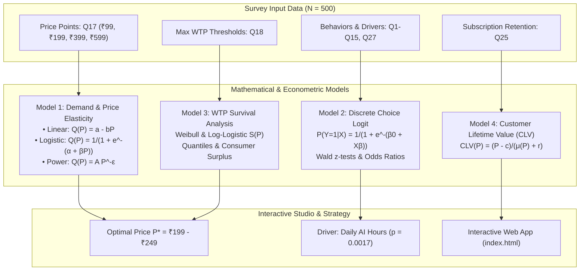
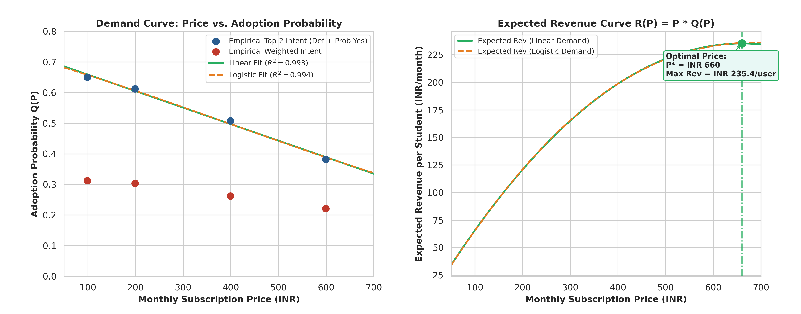
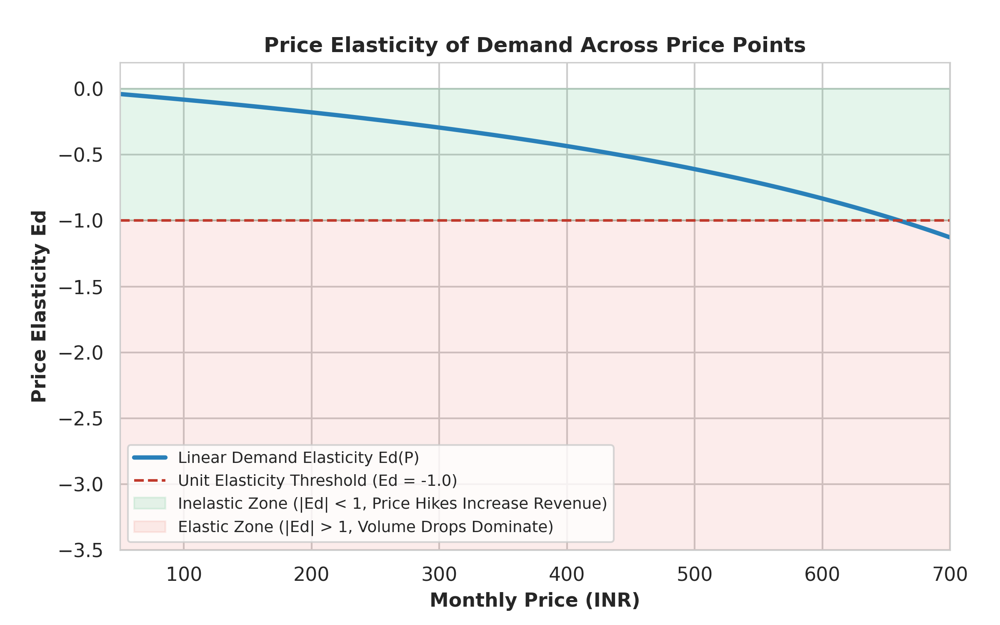
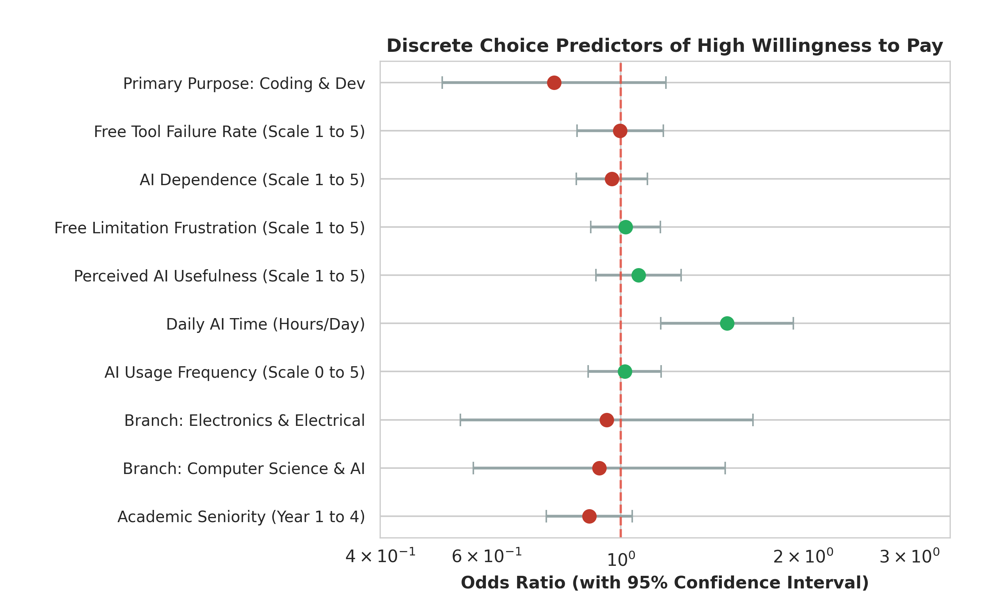
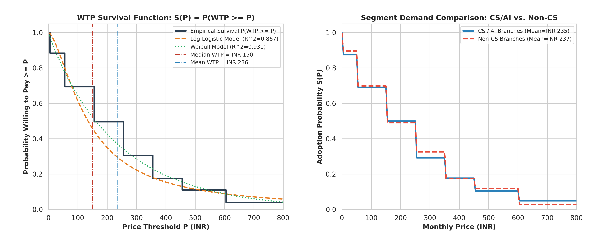
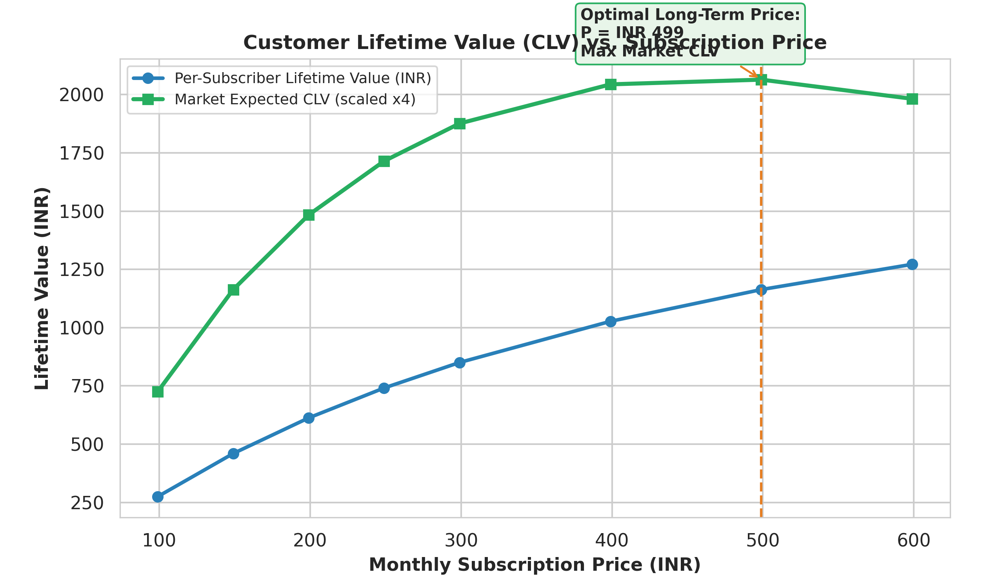

# Demand Modeling & Willingness-to-Pay (WTP) Optimization for Student AI Subscriptions

A comprehensive mathematical and econometric modeling suite developed for analyzing engineering students' adoption behaviors, price elasticity, and willingness to pay for generative AI tools. 

Includes microeconomic demand curves, discrete choice logistic regression, parametric survival distributions, customer lifetime value (CLV) optimization, and a full-featured interactive web studio.

---

## 1. Project Architecture



---

## 2. Mathematical Models & Findings

### Model 1: Microeconomic Demand & Price Elasticity
Demand $Q(P)$ represents the probability that a randomly sampled student subscribes at monthly price $P \in \mathbb{R}^+$. We estimate parametric demand functions across both Top-2 Box intent ($P(\text{Def Yes}) + P(\text{Prob Yes})$) and weighted intent (Juster scale):

- **Linear Demand Model** ($R^2 = 0.9931$):
  $$Q(P) = 0.7129 - 0.000540 \cdot P$$
  $$\text{Revenue: } R(P) = P \cdot Q(P) = 0.7129 P - 0.000540 P^2$$
  $$\text{Unconstrained Revenue-Maximizing Price: } P^* = \frac{0.7129}{2 \times 0.000540} = \text{₹}660.46$$
  $$\text{Point Elasticity: } E_d(P) = -0.000540 \frac{P}{Q(P)}$$

- **Logistic Demand Model** ($R^2 = 0.9943$):
  $$Q(P) = \frac{1}{1 + \exp\left(-(0.8728 - 0.002211 \cdot P)\right)}$$



- **Elasticity Schedule**: Demand is highly **inelastic** ($|E_d| < 0.40$) between ₹50 and ₹399. Unit elasticity ($E_d = -1.0$) is reached at $P \approx \text{₹}660$, beyond which price hikes produce net revenue contraction.



---

### Model 2: Econometric Discrete Choice Model (Logistic Regression)
To discover what behavioral drivers govern student subscription decisions, we estimate:
$$\ln\left(\frac{p_i}{1 - p_i}\right) = \beta_0 + \sum_{k=1}^K \beta_k X_{ik}$$

| Variable | Coefficient ($\beta$) | Std. Error | $z$-statistic | $p$-value | Odds Ratio ($e^\beta$) | 95% Conf. Interval |
| :--- | :--- | :--- | :--- | :--- | :--- | :--- |
| **Intercept** | 0.0442 | 0.6060 | 0.073 | 0.9419 | 1.045 | [0.319, 3.428] |
| **Academic Seniority** | -0.1201 | 0.0832 | -1.444 | 0.1487 | 0.887 | [0.753, 1.044] |
| **Branch: CS / AI / IT** | -0.0819 | 0.2447 | -0.335 | 0.7378 | 0.921 | [0.570, 1.488] |
| **Branch: ECE / EEE** | -0.0536 | 0.2842 | -0.189 | 0.8505 | 0.948 | [0.543, 1.654] |
| **AI Usage Frequency** | 0.0147 | 0.0711 | 0.207 | 0.8363 | 1.015 | [0.883, 1.167] |
| **Daily AI Time (Hours/day)** | **0.4041** | **0.1289** | **3.134** | **0.0017\*\*** | **1.498** | **[1.163, 1.929]** |
| **Perceived Usefulness (1-5)** | 0.0680 | 0.0827 | 0.823 | 0.4107 | 1.070 | [0.910, 1.259] |
| **Limitation Frustration (1-5)** | 0.0180 | 0.0675 | 0.267 | 0.7898 | 1.018 | [0.892, 1.162] |
| **AI Dependence (1-5)** | -0.0339 | 0.0690 | -0.492 | 0.6228 | 0.967 | [0.844, 1.107] |
| **Free Tool Failure (1-5)** | -0.0024 | 0.0836 | -0.029 | 0.9771 | 0.998 | [0.847, 1.175] |
| **Primary Purpose: Coding** | -0.2538 | 0.2173 | -1.168 | 0.2427 | 0.776 | [0.507, 1.188] |

> **Key Finding**: Daily AI time is the strongest behavioral determinant ($p = 0.0017$): **each extra hour of daily AI usage increases subscription odds by 49.8% (OR = 1.498)**.



---

### Model 3: Willingness-to-Pay (WTP) Survival Distributions
- **Weibull Survival Model** ($R^2 = 0.9312$):
  $$S(P) = \exp\left(-\left(\frac{P}{236.13}\right)^{0.9503}\right)$$
- **Log-Logistic Survival Model** ($R^2 = 0.8669$):
  $$S(P) = \frac{1}{1 + \left(\frac{P}{134.38}\right)^{1.5573}}$$
- **Empirical Statistics**: Median WTP = **₹150.00**, Mean WTP = **₹235.90**, Empirical peak revenue price = **₹250.00** ($49.6\%$ penetration).



---

### Model 4: Customer Lifetime Value (CLV) & Retention
With marginal compute cost $c = \text{₹}40/\text{month}$, monthly discount rate $r = 1.0\%$, and empirical churn hazard $\mu(P) = 0.16 + 0.00045 P$:
$$\text{CLV}(P) = \frac{P - c}{\mu(P) + r}$$

| Price | Conversion $Q(P)$ | Expected Tenure | Subscriber CLV | Campus Market CLV |
| :--- | :--- | :--- | :--- | :--- |
| **₹99** | 65.9% | 4.89 months | ₹275.00 | ₹181.34 |
| **₹149** | 63.2% | 4.40 months | ₹459.82 | ₹290.81 |
| **₹199** | **60.5%** | **4.01 months** | **₹612.60** | **₹370.90** |
| **₹249** | **57.8%** | **3.68 months** | **₹741.00** | **₹428.65** |
| **₹399** | 49.8% | 2.95 months | ₹1,027.03 | ₹510.98 |
| **₹499** | 44.4% | 2.60 months | ₹1,163.35 | ₹516.02 (Peak CLV) |



---

## 3. Interactive Web Studio (`index.html`)

A full interactive single-page application is provided in `index.html`:
- **Pricing & Demand Curve Simulator**: Drag the price slider to observe real-time demand, revenue, and point elasticity.
- **Student Propensity Tester**: Test any hypothetical student profile using the econometric logit formula.
- **CLV & Cost Architecture**: Vary marginal inference costs and discount rates.
- **Batch Evaluation Engine**: Score multiple student records simultaneously via CSV/JSON.

### Running Locally
```bash
# Clone the repository
git clone https://github.com/Prajwal-Personal/Demand-Modeling.git
cd Demand-Modeling

# Start the web server
python -m http.server 8080

# Open in browser:
# http://localhost:8080/index.html
```

---

## 4. Repository Structure

```
├── Data.xlsx               # Survey responses dataset (N = 500)
├── index.html              # Interactive simulation studio web application
├── estimate_models.py      # Full econometric & mathematical modeling script
├── model_pipeline.py       # Data cleaning and variable mapping pipeline
├── model_results.json      # Structured parameter outputs and statistical metrics
├── plots/                  # High-resolution generated charts
│   ├── fig1_demand_and_revenue.png
│   ├── fig2_price_elasticity.png
│   ├── fig3_logistic_odds_ratios.png
│   ├── fig4_wtp_survival_and_segments.png
│   └── fig5_clv_curve.png
└── README.md               # Mathematical documentation & guide
```

---

## 5. Requirements & Installation

```bash
pip install numpy scipy pandas statsmodels scikit-learn matplotlib seaborn openpyxl
python estimate_models.py
```
